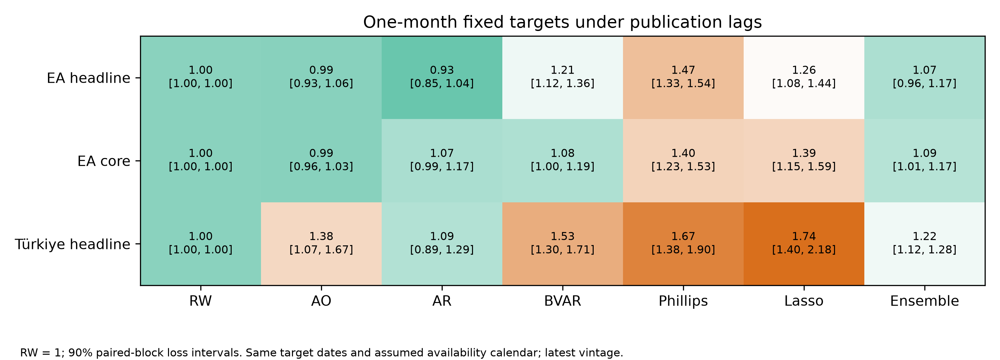

# Inflation forecasts with publication lags

Do fixed inflation models improve on simple benchmarks when we respect assumed publication delays, and how sensitive are German GDP nowcasts to pandemic quarters?

We forecast fixed year-on-year inflation targets at horizons of 1, 3, 6 and 12 months using expanding training windows and unchanged model settings. We assume final prices are published one month after their reference month and unemployment two months later, and forecast the extra steps from each effective data cutoff to the fixed target. We compare model errors against random-walk and Atkeson-Ohanian-style rules using paired loss intervals and fixed-bandwidth DM-HLN tests. We also compare bridge, MIDAS and factor nowcasts for German GDP under simulated release masks.

- With publication delays, EA core BVAR/RW RMSE is 1.077 (90% loss interval 0.999, 1.193) and the EA headline ensemble/RW ratio is 1.071 (0.960, 1.167). These results do not support a general accuracy gain over the random walk.
- Türkiye deteriorates at h = 12: BVAR/RW RMSE is 2.389 and AR/RW is 1.950. The 2021-23 inflation surge is consistent with difficult regime adaptation, but this comparison does not identify its separate causal contribution.
- German GDP nowcasts are pandemic-sensitive: month-3 DFM/bridge RMSE is 1.552 (0.778, 1.709) overall and 0.822 (0.702, 0.971) excluding 2020Q1-2021Q2. GDP is q/q log growth, not annualised.

## Limitations

- Publication masks on latest-vintage data do not recreate historical vintages.
- The conservative unemployment delay reduces information for models using it.
- Fixed HAC and loss-bootstrap rules may leave dependence unaccounted for.
- Fixed learners and priors may adapt poorly to an inflation regime change.
- GDP rankings are pandemic-sensitive and some factor fits did not converge.

## Technical notes

This is publication-lag-adjusted, latest-vintage pseudo-real-time evaluation. Price and unemployment delays are assumptions, not exact historical release calendars. All models share target dates; target-only and complete-panel models use their appropriate effective cutoffs. The technical report presents the assumption-based seasonal-mean benchmark outside the ensemble, separate information-set/HAC comparisons and loss-bootstrap limitations.

Eurostat and CBRT/EVDS-TURKSTAT. Atkeson and Ohanian (2001), DOI: 10.21034/qr.2511.
